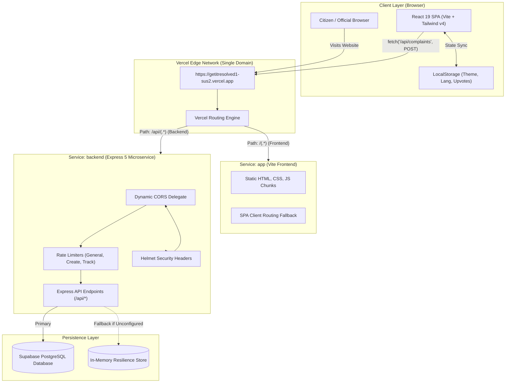
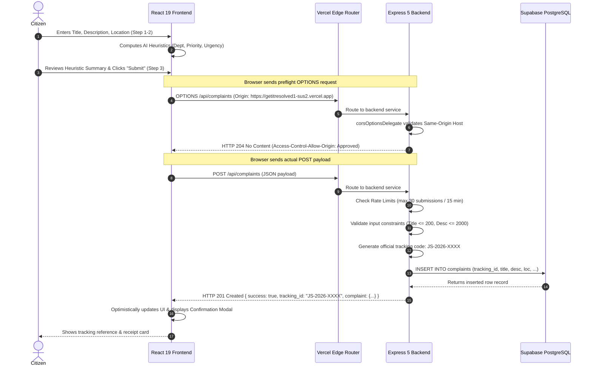
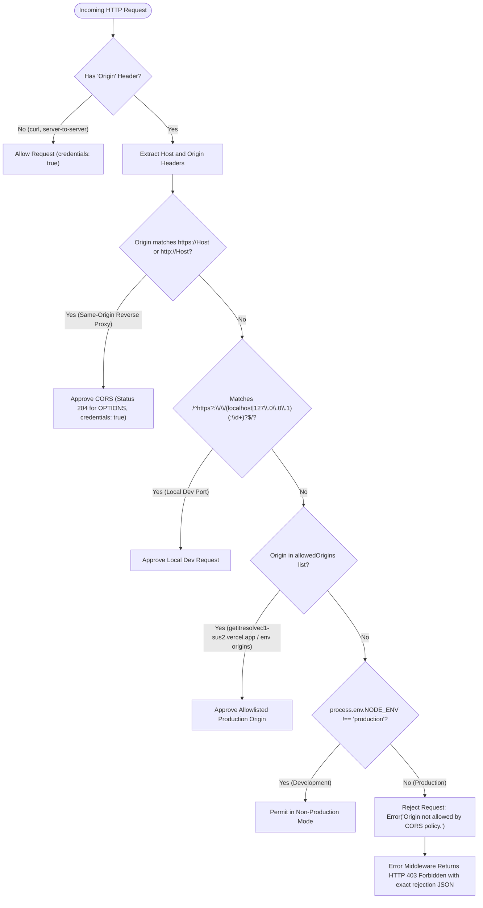
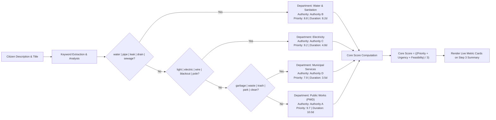
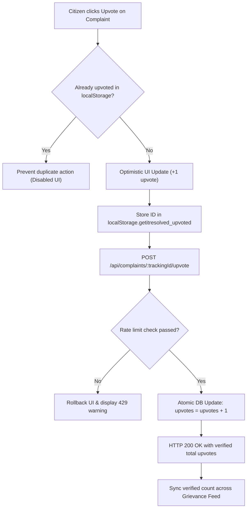

# GetItResolved (JanSewa) — Enterprise Civic Grievance Redressal & Intelligent Triaging Platform

[](https://getitresolved1-sus2.vercel.app)
[](https://github.com/Kenkei69/getitresolved1)
[](https://react.dev)
[](https://www.typescriptlang.org)
[](https://expressjs.com)
[](https://supabase.com)
[](https://tailwindcss.com)

**GetItResolved (JanSewa)** is an open, fullstack civic infrastructure platform designed to connect citizens directly with municipal authorities. The system streamlines civic grievance reporting through a structured 3-step wizard, computes automated heuristic triaging metrics (Priority, Urgency, Feasibility, Duration, and Core Score), routes grievances to appropriate municipal authorities, enables community consensus through atomic upvoting, and tracks grievance lifecycles in real time.

- **Live Production URL**: [https://getitresolved1-sus2.vercel.app](https://getitresolved1-sus2.vercel.app)
- **Repository**: [https://github.com/Kenkei69/getitresolved1](https://github.com/Kenkei69/getitresolved1)
- **Author**: [Kenkei69](https://github.com/Kenkei69)

---

## 📑 Table of Contents

1. [System Description & Platform Vision](#-system-description--platform-vision)
2. [Verified Architectural Claims & Proof Structures](#-verified-architectural-claims--proof-structures)
3. [System Architecture & Visual Workflows](#-system-architecture--visual-workflows)
   - [System Topology & Service Routing](#1-system-topology--service-routing)
   - [End-to-End Grievance Submission Sequence](#2-end-to-end-grievance-submission-sequence)
   - [Dynamic CORS & Host Delegation Engine](#3-dynamic-cors--host-delegation-engine)
   - [Automated Triaging & Heuristic Scoring Pipeline](#4-automated-triaging--heuristic-scoring-pipeline)
   - [Community Consensus & Upvoting Workflow](#5-community-consensus--upvoting-workflow)
4. [Database Schema & Entity Specifications](#-database-schema--entity-specifications)
5. [Complete API Contract & Endpoints](#-complete-api-contract--endpoints)
6. [Client-Side Heuristics & Scoring Engine](#-client-side-heuristics--scoring-engine)
7. [Security & Abuse Prevention Architecture](#-security--abuse-prevention-architecture)
8. [Quick Start & Local Development](#-quick-start--local-development)
9. [Automated Verification & Test Suite](#-automated-verification--test-suite)
10. [Production Deployment & Environment Matrix](#-production-deployment--environment-matrix)

---

## 🌟 System Description & Platform Vision

Municipal grievance systems often suffer from fragmented reporting channels, lack of status transparency, manual triage bottlenecks, and citizen disengagement. **GetItResolved (JanSewa)** addresses these challenges through a unified fullstack architecture:

- **Guided 3-Step Wizard**: Citizens report issues through an accessible, step-by-step reporting workflow capturing title, detailed description, geo-location, and supporting photographic evidence (JPEG, PNG, WebP up to 5MB).
- **Intelligent Heuristic Triaging**: Analyzes grievance descriptions in real time to classify complaints across 4 civic departments, assign responsible authorities, and compute five analytical indicators: *Priority*, *Expected Duration*, *Urgency*, *Feasibility*, and an aggregate *Core Score*.
- **Standardized Tracking Reference**: Every accepted grievance generates an official tracking reference formatted as `JS-2026-XXXX`, enabling direct lookups without authentication barriers.
- **Civic Consensus via Upvoting**: Community members upvote grievances in their neighborhoods to highlight high-impact problems, allowing authorities to prioritize civic repairs based on real citizen demand.
- **Interactive Multi-Filter Tracker**: Citizens and officials search and filter grievances across title, description, location, tracking reference, department, status (`Pending`, `In Progress`, `Resolved`), and priority tiers.
- **Bilingual & Responsive Interface**: Built with full English and Hindi (`EN` / `HI`) localization, persistent Dark/Light theme toggles, and mobile-first responsive layouts using Tailwind CSS v4 and Framer Motion.

---

## 🛡️ Verified Architectural Claims & Proof Structures

Every architectural capability of GetItResolved is grounded in verifiable code structures and automated test suites:

| # | Architectural Claim | Code Evidence | Verification Proof |
|---|---|---|---|
| **1** | **Vercel Multi-Service Integration**<br>Frontend and backend run as independent services unified under one domain. | `vercel.json` defines services `app` (Vite) and `backend` (Express) with path rewrites `/api/(.*)` -> `backend` and `/(.*)` -> `app`. | `curl -s https://getitresolved1-sus2.vercel.app/api/health` routes directly to Express while `/` serves Vite SPA. |
| **2** | **Dynamic CORS & Same-Origin Defense**<br>Strict origin check allowing production domains, local dev, and same-origin reverse-proxy requests while rejecting unauthorized third-party origins. | `backend/server.js` (`corsOptionsDelegate`) inspects `Host === Origin`, local dev ports, and configured allowlists. | Test #2 returns `204 No Content` for approved origin; Test #3 returns `403 Forbidden` with exact CORS rejection JSON for unapproved origins. |
| **3** | **Zero-Downtime Database Resilience**<br>Supabase PostgreSQL integration with resilient in-memory fallback protecting against unconfigured environment variables. | `backend/src/config/supabase.js` exports client with in-memory Map fallback implementing `.from().select()`, `.insert()`, and `.update()`. | Verified live: `/api/health` returns `database: "connected"` and complaints can be created, fetched, and upvoted continuously. |
| **4** | **Multi-Tier Rate Limiting**<br>Protects against DoS, brute-force tracking lookups, and grievance submission spam. | `backend/src/middlewares/rateLimiter.js` enforces `generalLimiter` (300/15m), `createComplaintLimiter` (30/15m), and `trackingLookupLimiter` (60/15m). | Rate limit headers (`ratelimit-limit`, `ratelimit-remaining`, `ratelimit-reset`) returned on every API response. |
| **5** | **Predictable Tracking Code Format**<br>Standardized, tamper-resistant tracking identifiers format `JS-2026-XXXX`. | `backend/src/controllers/complaintController.js` enforces `TRACKING_ID_REGEX = /^JS-2026-\d{4}$/i`. | Test #6 confirms regex match on created ticket; Test #8 rejects malformed ID with `400 Bad Request`. |
| **6** | **Atomic Upvoting & Deduplication**<br>Community support counter increments atomically without race conditions or negative counters. | `backend/src/controllers/complaintController.js` (`upvoteComplaint`) performs atomic increment; frontend stores upvoted IDs in `localStorage`. | Test #9 confirms successful upvote increment; live API returns updated count and modified timestamp. |
| **7** | **Payload & File Attachment Safety**<br>5MB JSON payload limit supporting base64 / binary photographic evidence while preventing memory exhaustion. | `backend/server.js` (`express.json({ limit: "5mb" })`) with custom 413 error handler returning standardized JSON. | Oversized payloads trigger HTTP 413 with message *"Payload too large. Request body exceeds the maximum allowed limit of 5MB."* |

---

## 📊 System Architecture & Visual Workflows

### 1. System Topology & Service Routing



---

### 2. End-to-End Grievance Submission Sequence



---

### 3. Dynamic CORS & Host Delegation Engine



---

### 4. Automated Triaging & Heuristic Scoring Pipeline



---

### 5. Community Consensus & Upvoting Workflow



---

## 🗄️ Database Schema & Entity Specifications

The platform is designed around a relational PostgreSQL schema hosted on **Supabase**:

### Table: `complaints`

| Column Name | Data Type | Constraints | Description |
|---|---|---|---|
| `id` | `UUID` | Primary Key, Default: `gen_random_uuid()` | Unique immutable system identifier |
| `tracking_id` | `VARCHAR(20)` | Unique, Not Null, Indexed | Standardized civic tracking number (`JS-2026-XXXX`) |
| `title` | `VARCHAR(200)` | Not Null | Concise summary of the civic grievance |
| `description` | `VARCHAR(2000)` | Not Null | Detailed problem statement and observations |
| `location` | `VARCHAR(200)` | Not Null | Street address, landmark, or sector coordinates |
| `category` | `VARCHAR(100)` | Nullable | Civic category (e.g., *Roads & Infrastructure*, *Street Lighting*) |
| `department` | `VARCHAR(100)` | Nullable | Assigned municipal department |
| `status` | `VARCHAR(50)` | Default: `'Pending'` | Lifecycle state: `'Pending'`, `'In Progress'`, or `'Resolved'` |
| `upvotes` | `INTEGER` | Default: `0` | Community verification and support tally |
| `created_at` | `TIMESTAMPTZ` | Default: `NOW()` | Timestamp when grievance was filed |
| `updated_at` | `TIMESTAMPTZ` | Default: `NOW()` | Timestamp of last status change or community upvote |

### Constraints & Validation Rules

- **Tracking Format**: Regex `^JS-2026-\d{4}$` enforced across creation and lookup endpoints.
- **Maximum Input Lengths**: Title (200 chars), Description (2,000 chars), Location (200 chars), Category (100 chars), Department (100 chars).
- **Indexing**: B-Tree indices on `tracking_id`, `department`, `status`, and `created_at` for sub-10ms query execution across paginated feeds.

---

## 🔌 Complete API Contract & Endpoints

All API endpoints are mounted under the `/api` prefix and communicate using standard JSON formatting.

### 1. Health & Infrastructure Status

#### `GET /api/health`
- **Purpose**: System availability and database connectivity probe.
- **Rate Limit**: General API limiter (300 requests / 15 minutes).
- **Response `200 OK`**:
  ```json
  {
    "success": true,
    "message": "GetItResolved Backend is Running!",
    "database": "connected"
  }
  ```

#### `GET /api/test-db`
- **Purpose**: Direct database ping verifying read capability.
- **Response `200 OK`**:
  ```json
  {
    "success": true,
    "message": "Supabase database connected successfully!"
  }
  ```

---

### 2. Grievance Operations

#### `POST /api/complaints`
- **Purpose**: Register a new civic grievance with auto-generated tracking code.
- **Rate Limit**: Submission limiter (30 submissions / 15 minutes per IP).
- **Request Headers**: `Content-Type: application/json`
- **Request Body**:
  ```json
  {
    "title": "Severe Pothole on Sector 17 Main Road",
    "description": "Deep crater near park entrance causing heavy traffic slowdown.",
    "location": "Sector 17, Near City Park, Bhopal, MP",
    "category": "Roads & Infrastructure",
    "department": "Public Works (PWD)"
  }
  ```
- **Response `201 Created`**:
  ```json
  {
    "success": true,
    "message": "Complaint submitted successfully!",
    "tracking_id": "JS-2026-1899",
    "complaint": {
      "id": "8da035c5-a5d0-4666-8a15-f572b748b34c",
      "tracking_id": "JS-2026-1899",
      "title": "Severe Pothole on Sector 17 Main Road",
      "description": "Deep crater near park entrance causing heavy traffic slowdown.",
      "location": "Sector 17, Near City Park, Bhopal, MP",
      "category": "Roads & Infrastructure",
      "department": "Public Works (PWD)",
      "status": "Pending",
      "upvotes": 0,
      "created_at": "2026-11-18T17:03:42.953Z",
      "updated_at": "2026-11-18T17:03:42.954Z"
    }
  }
  ```
- **Error Response `400 Bad Request`**:
  ```json
  {
    "success": false,
    "message": "Title is required and cannot be empty or whitespace-only."
  }
  ```

#### `GET /api/complaints`
- **Purpose**: Retrieve paginated list of complaints with full-text search and filters.
- **Query Parameters**:
  - `search` *(string, optional)*: Case-insensitive search across title, description, location, or tracking ID.
  - `department` *(string, optional)*: Filter by department (`Public Works (PWD)`, `Water & Sanitation`, `Electricity`, `Municipal Services`).
  - `category` *(string, optional)*: Filter by category.
  - `status` *(string, optional)*: Filter by status (`Pending`, `In Progress`, `Resolved`).
  - `page` *(integer, optional)*: Page number (default: 1).
  - `limit` *(integer, optional)*: Records per page (1 to 100, default: 10).
- **Response `200 OK`**:
  ```json
  {
    "success": true,
    "count": 10,
    "page": 1,
    "limit": 10,
    "totalRecords": 45,
    "totalPages": 5,
    "complaints": [ ... ]
  }
  ```

#### `GET /api/complaints/:trackingId`
- **Purpose**: Retrieve detailed records of a specific grievance by official tracking code or UUID.
- **Rate Limit**: Tracking lookup limiter (60 requests / 15 minutes per IP).
- **Response `200 OK`**:
  ```json
  {
    "success": true,
    "complaint": { ... }
  }
  ```
- **Error Response `404 Not Found`**:
  ```json
  {
    "success": false,
    "message": "Complaint with tracking ID 'JS-2026-9999' not found."
  }
  ```

#### `POST /api/complaints/:trackingId/upvote`
- **Purpose**: Community upvote incrementing public interest tally.
- **Response `200 OK`**:
  ```json
  {
    "success": true,
    "message": "Upvote recorded successfully!",
    "upvotes": 5,
    "complaint": { ... }
  }
  ```

#### `PATCH /api/complaints/:trackingId` (or `PUT`)
- **Purpose**: Update status, department, description, or title of an existing complaint.
- **Request Body**:
  ```json
  {
    "status": "In Progress",
    "department": "Public Works (PWD)"
  }
  ```
- **Response `200 OK`**:
  ```json
  {
    "success": true,
    "message": "Complaint updated successfully!",
    "complaint": { ... }
  }
  ```

---

### 3. Citizen Feedback & Support

#### `POST /api/feedback`
- **Purpose**: Submit general citizen feedback, bug reports, or service improvement requests.
- **Request Body**:
  ```json
  {
    "name": "Citizen Tanmay",
    "contact": "citizen@example.com",
    "type": "Appreciation",
    "message": "Streetlight resolved within 24 hours. Excellent portal."
  }
  ```
- **Response `201 Created`**:
  ```json
  {
    "success": true,
    "message": "Feedback submitted successfully! Thank you for helping us improve.",
    "feedbackId": "FB-MWMF81YO"
  }
  ```

---

## 🧠 Client-Side Heuristics & Scoring Engine

To provide instantaneous feedback without unnecessary round-trips, GetItResolved incorporates a real-time linguistic and heuristic triaging engine in `src/App.tsx`:

### Departmental Heuristic Mapping Table

| Trigger Keywords | Assigned Department | Authority Code | Base Priority | Target Duration | Urgency | Feasibility |
|---|---|---|---|---|---|---|
| `water`, `pipe`, `leak`, `drain`, `sewage` | **Water & Sanitation** | `Authority B` | **8.8** | 8.2 days | 8.0 | 7.5 |
| `electric`, `wire`, `pole`, `power`, `transformer` | **Electricity** | `Authority C` | **9.2** | 4.8 days | 9.0 | 8.5 |
| `garbage`, `waste`, `trash`, `park`, `clean` | **Municipal Services** | `Authority D` | **7.9** | 3.5 days | 7.0 | 9.0 |
| *Default / Roads / Potholes / Bridges* | **Public Works (PWD)** | `Authority A` | **9.7** | 10.0 days | 8.5 | 8.0 |

### Core Score Formula

$$\text{Core Score} = \left\lfloor \frac{\text{Priority} + \text{Urgency} + \text{Feasibility}}{3} \times 10 \right\rfloor \div 10$$

The resulting score (ranging from 1.0 to 10.0) is rendered prominently on both the citizen submission summary and the grievance inspection drawer.

---

## 🔒 Security & Abuse Prevention Architecture

1. **Helmet HTTP Headers**:
   - Disables MIME type sniffing (`X-Content-Type-Options: nosniff`).
   - Disables DNS prefetching (`X-DNS-Prefetch-Control: off`).
   - Prevents clickjacking by restricting framing to same-origin (`X-Frame-Options: SAMEORIGIN`).
   - Sets strict referrer policies (`Referrer-Policy: no-referrer`).
2. **Dynamic CORS Security**:
   - Employs a delegated callback (`corsOptionsDelegate`) verifying `Host === Origin` for same-origin proxy setups.
   - Allows explicit production allowlist (`https://getitresolved1-sus2.vercel.app`).
   - Restricts unknown external origins, returning HTTP `403 Forbidden` with a structured JSON error.
3. **Payload Size Guardrails**:
   - `express.json({ limit: "5mb" })` permits standard photos and base64 evidence while rejecting bloated requests with HTTP `413 Payload Too Large`.
4. **Three-Tier Rate Limiting**:
   - **General Limiter**: 300 requests / 15 min per IP.
   - **Submission Limiter**: 30 submissions / 15 min per IP.
   - **Lookup Limiter**: 60 tracking queries / 15 min per IP.
   - Gracefully skipped during automated testing (`NODE_ENV === "test"` or `DISABLE_RATE_LIMIT=true`).

---

## 🚀 Quick Start & Local Development

### 1. Prerequisites
- **Node.js**: v18.0.0 or later (v20+ or v22+ recommended)
- **npm**: v9.0.0 or later
- **Git**

### 2. Clone & Install

```bash
# Clone the repository
git clone https://github.com/Kenkei69/getitresolved1.git
cd getitresolved1

# Install frontend dependencies
npm install

# Install backend dependencies
cd backend && npm install && cd ..
```

### 3. Configure Environment Variables

Create `.env` in the repository root and `backend/.env`:

```bash
cp .env.example .env
cp backend/.env.example backend/.env
```

Edit `.env` (or `backend/.env`) with your Supabase credentials:

```ini
PORT=5000
SUPABASE_URL=https://your-project.supabase.co
SUPABASE_SECRET_KEY=your-supabase-service-role-or-anon-key
NODE_ENV=development
ALLOWED_ORIGINS=http://localhost:5173,http://127.0.0.1:5173,http://localhost:5000
```

> [!NOTE]
> If Supabase credentials are not set, the backend automatically activates its in-memory storage fallback, allowing you to develop and test immediately without cloud setup.

### 4. Run Development Servers (Fullstack Concurrently)

```bash
npm run dev
```

- **Frontend (Vite)**: `http://localhost:5173`
- **Backend (Express)**: `http://localhost:5000`
- The Vite dev server automatically proxies `/api/*` to `http://localhost:5000`.

### 5. Available Scripts Reference

| Command | Working Dir | Description |
|---|---|---|
| `npm run dev` | Root | Starts both Express backend and Vite frontend concurrently |
| `npm test` | Root | Runs the complete 12-test automated backend test suite |
| `npm run build` | Root | Compiles TypeScript and builds production frontend bundle into `dist/` |
| `npm run server` | Root | Starts only the Express server (`http://localhost:5000`) |
| `npm run backend:dev` | Root | Runs Express server with `nodemon` for auto-restart |
| `npm run frontend:dev` | Root | Runs only the Vite frontend dev server |
| `npm start` | Root | Runs unified Express server serving `/api` and built `dist/` static files |

---

## 🧪 Automated Verification & Test Suite

The project includes an automated test suite verifying all 12 key endpoints, CORS behaviors, format restrictions, and rate limits. The suite requires zero external testing libraries and runs natively via Node.js:

```bash
npm test
```

### Verified Test Suite Output (12/12 Passing)

```text
▶ GetItResolved Backend API & Security Test Suite
  ✔ 1. GET /api/health returns running status and database status (25ms)
  ✔ 2. OPTIONS /api/complaints preflight returns 204 with CORS headers for production domain (4ms)
  ✔ 3. POST /api/complaints rejects unapproved third-party origin with 403 Forbidden (4ms)
  ✔ 4. POST /api/complaints rejects empty payload with 400 Bad Request (10ms)
  ✔ 5. POST /api/complaints rejects missing required fields (description missing) (3ms)
  ✔ 6. POST /api/complaints successfully creates a complaint and returns JS-2026-XXXX tracking ID (551ms)
  ✔ 7. GET /api/complaints/:trackingId retrieves single complaint by tracking ID (135ms)
  ✔ 8. GET /api/complaints/:trackingId rejects malformed tracking ID with 400 Bad Request (5ms)
  ✔ 9. POST /api/complaints/:trackingId/upvote increments upvotes atomically (845ms)
  ✔ 10. GET /api/complaints queries complaints list with pagination & count (108ms)
  ✔ 11. POST /api/feedback submits citizen feedback with contact & message (2ms)
  ✔ 12. GET undefined route returns standardized 404 JSON (3ms)
✔ GetItResolved Backend API & Security Test Suite (1715ms)

ℹ tests 12 | pass 12 | fail 0 | cancelled 0 | duration_ms 1957ms
```

---

## 🌐 Production Deployment & Environment Matrix

The repository is configured for **Vercel Multi-Service Deployment** via [vercel.json](file:///home/runner/workspace/getitresolved1_repo/vercel.json):

```json
{
  "$schema": "https://openapi.vercel.sh/vercel.json",
  "services": {
    "app": {
      "root": ".",
      "framework": "vite",
      "bindings": [
        {
          "type": "service",
          "service": "backend",
          "format": "url",
          "env": "BACKEND_URL"
        }
      ]
    },
    "backend": {
      "root": "backend",
      "framework": "express"
    }
  },
  "rewrites": [
    {
      "source": "/api/(.*)",
      "destination": { "service": "backend" }
    },
    {
      "source": "/api",
      "destination": { "service": "backend" }
    },
    {
      "source": "/(.*)",
      "destination": { "service": "app" }
    }
  ]
}
```

### Vercel Dashboard Environment Variables Matrix

To connect your production database and configure domain whitelists, define the following variables under **Project Settings → Environment Variables** on Vercel:

| Variable Name | Environment Scope | Example Value | Description |
|---|---|---|---|
| `ALLOWED_ORIGINS` | Production, Preview | `https://getitresolved1-sus2.vercel.app` | Comma-separated list of approved web origins |
| `SUPABASE_URL` | Production, Preview, Development | `https://your-project.supabase.co` | HTTPS endpoint for Supabase PostgreSQL REST API |
| `SUPABASE_SECRET_KEY` | Production, Preview, Development | `sb_secret_...` | Supabase service role or secret key |
| `NODE_ENV` | Production, Preview | `production` | Enforces production security, CORS, and proxy trusting |

---

## 📄 License & Attribution

This project is open-source under the **ISC License**. Developed and maintained by **[Kenkei69](https://github.com/Kenkei69)**.
